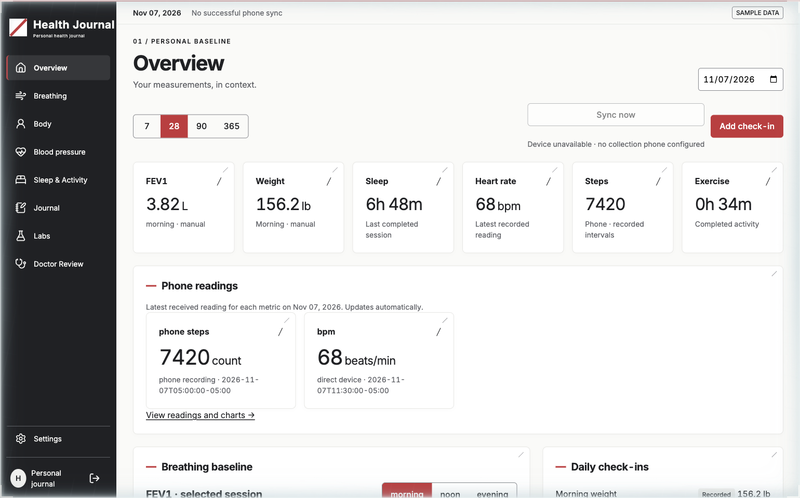

# Health Journal

A Raspberry Pi health journal that brings daily check-ins, phone readings, lab reports and notes together on a private desktop dashboard.



*The screenshot shows one day in the built-in fictional journal. You can explore the same data locally without a Pi, phone or account.*

## Features

- Review a day at a glance, then open Breathing, Body, Blood pressure or Sleep & Activity to inspect the underlying measurements.
- Keep daily observations alongside journal entries and lab documents. Use Doctor Review to prepare for a conversation about your records.
- Accept uploads from registered phones. The ingestion contract covers batch submission, retries and receipts so a client can tell when a reading has been accepted.
- Keep the dashboard on the Pi’s loopback interface. A separately configured tunnel exposes the phone ingestion routes. The backend uses PostgreSQL, encrypted blob storage and OpenBao.

## Requirements

For the fictional preview, install Git, Bash, Node.js **24.x** and pnpm **10.x**. The frontend pins pnpm **10.34.9**. For the appliance, you also need Linux with systemd, Python **3.12**, uv, PostgreSQL and a provisioned OpenBao service. See the [Pi production guide](docs/operations/pi-production.md) before preparing a device for real records.

## Quick start

Copy the repository’s clone URL from its hosting page. In a terminal, replace the quoted URL below with that address.

```sh
git clone '<repository-clone-url>' health-journal
cd health-journal
cp .env.example .env
scripts/frontend install --frozen-lockfile
scripts/frontend dev --port 45175
```

Open **http://127.0.0.1:45175/overview**. Look for **SAMPLE DATA** in the top right. The preview reads checked-in fictional responses and rejects changes. The supplied defaults work as-is. Stop the preview with Ctrl+C.

## Configuration

The frontend reads the root `.env` file. To change the journal title, uncomment `VITE_SITE_NAME`, set the name, and restart the dev server. All `VITE_` values are public in the browser build. For backend commands, export the settings you use. On the Pi, the systemd units read `/etc/health03/runtime.env` and load credentials from separate files. See the [environment template](.env.example).

<details>
<summary>Environment reference by task</summary>

| Setting | Purpose | Example |
| --- | --- | --- |
| `VITE_SITE_NAME` | Dashboard title | Health Journal |
| `VITE_SITE_TAGLINE` | Subtitle beneath the title | Personal health journal |
| `JOURNAL_TIMEZONE` | Display timezone and default phone timezone | UTC |
| `VITE_LOCAL_DESKTOP` | Enable trusted local desktop mode in a Pi build | 1 |
| `VITE_API_BASE_URL` | Browser API base | https://localhost:8443/api/v1 |
| `HEALTH03_ENV` | Backend profile | development |
| `HEALTH03_PI_APPLIANCE` | Select Pi appliance configuration | 1 |
| `HEALTH03_LOCAL_DESKTOP` | Backend local desktop mode | 1 |
| `HEALTH03_UPLOAD_HOST` | Dedicated public phone hostname | phone.example.org |
| `FRONTEND_ORIGIN`, `API_ORIGIN` | Exact browser dashboard and API origins | https://localhost:5173 and https://localhost:8443 |
| `API_HOSTNAME` | Browser API hostname | localhost |
| `HEALTH03_PROXY_PORT`, `HEALTH03_UPSTREAM_PORT` | Local proxy listener and its backend destination | 8443 and 8010 |
| `HEALTH03_RELEASE_GATE` | Approved release manifest path | /etc/health03/release.json |
| `HEALTH03_RELEASE_ID`, `HEALTH03_DEPLOYED_REVISION` | Approved release identifier and full deployed revision | Use the approved release’s values |
| `PGDATABASE`, `PGUSER` | Database and local peer role | health03_dev and health03-app |
| `PGHOST`, `PGPORT` | Database socket directory or host, and port | /var/run/postgresql and 5432 |
| `PGPASSWORD`, `DJANGO_SECRET_KEY` | Optional test database password and Django signing secret | Supply private development values only when needed |
| `HEALTH03_BLOB_ROOT`, `HEALTH03_SHARED_BLOBS` | Encrypted file directory and group-readable blob mode | /var/lib/health03/blobs and 1 |
| `KMS_CA_FILE` | CA for the key service | /etc/health03/bao-server-ca.crt |
| `HEALTH03_SOURCE_LOOKUP_VERSIONS` | Comma-separated source lookup versions | 1 |
| `ANDROID_CLIENT_ID` | Registered mobile OAuth client | Your registered public client ID |
| `SMTP_HOST`, `SMTP_PORT` | Mail relay address and port | smtp.example.org and 587 |
| `SMTP_USER`, `SMTP_FROM` | Mail relay account and sender | Deployment account and journal@example.org |
| `HEALTH03_BACKUPS_ENABLED` | Enable backups after provisioning the destination | 0 (default) |
| `BACKUP_STAGING`, `BACKUP_TARGET_CONFIG` | Private staging directory and target configuration | Operator paths; see [target example](infra/backup-target.example.json) |
| `RECOVERY_LOCATIONS_FILE` | Private inventory of recovery locations | Operator-managed file |
| `HEALTH03_LEDGER_DB` | Database file on the optional ledger receiver | Private receiver database path |
| `LEDGER_SSH_DESTINATION`, `LEDGER_SSH_KEY`, `LEDGER_KNOWN_HOSTS` | Ledger receiver, client identity file and pinned host keys | Operator-managed destination and files |
| `SSH_ORIGINAL_COMMAND` | Command inspected by the restricted ledger receiver | Supplied by SSH |
| `RESTORE_DIRECTORY` | Isolated restore destination | Dedicated recovery directory |
| `RESTORE_KMS_ADDRESS`, `RESTORE_KMS_CA_FILE` | Recovery key service and its CA | Isolated service URL and CA path |
| `RESTORE_KMS_CLIENT_CERT`, `RESTORE_KMS_CLIENT_KEY` | Recovery client certificate and private key | Private recovery file paths |
| `RESTORE_KMS_INITIAL_TOKEN_FILE` | Initial token file for isolated recovery | Private recovery file path |
| `RESTORE_SHARE_1_FILE`, `RESTORE_SHARE_2_FILE` | Unlock share files for isolated recovery | Two separately managed file paths |
| `RESTORE_LEDGER_EXPORT`, `RESTORE_LEDGER_HEAD` | Recovery ledger export and expected head | Inputs from the independent receiver |
| `HEALTH03_SAMPLE_URL`, `HEALTH03_E2E_URL` | Targets for smoke checks and end-to-end tests | Local synthetic test origins |
| `HEALTH03_CHECK_DATE` | Date to inspect in smoke checks | 2026-11-07 |
| `HEALTH03_REAL_KMS_TESTS` | Enable real key-service tests | 1 in an isolated test environment |
| `HEALTH03_DELETE_FIXTURE` | Enable destructive teardown of the isolated test fixture | 1 for a disposable fixture only |

</details>

## Adding your own data

Start with a provisioned Pi. Use **Add check-in** on Overview to enter a daily observation. Use Journal for notes and Labs for laboratory documents. To see how a phone client should identify a batch, retry it and read the receipt, start with the [phone contract and sample payloads](contracts/phone/README.md). This repository contains the Pi side of that integration.

For UI development, the [sample responses](contracts/fixtures/health03-v1/responses.json) supply the preview and the [mock handlers](frontend/src/mocks/browser.ts) serve them. Keep these fixtures fictional. The [frontend guide](docs/frontend/local-running.md) explains how to recreate the isolated acceptance fixture.

## Build and deploy

From the repository root after the frontend install, build the trusted desktop bundle and check that the static files serve locally:

```sh
VITE_LOCAL_DESKTOP=1 scripts/frontend build
scripts/frontend preview --port 5176
```

Open **http://127.0.0.1:5176/** on a fresh checkout. The build writes to `frontend/dist/`. Interactive production pages require the configured backend and trusted desktop proxy. Use the quick start for the populated standalone demo.

For deployment, follow the [Pi production guide](docs/operations/pi-production.md) in order. It covers staging the release, provisioning database roles and encryption, approving the revision, installing systemd services, and verifying a synthetic upload after reboot. The desktop serves HTTPS on loopback port 5173 and its API proxy on 8443. Only the dedicated phone hostname belongs on the external tunnel.

## Security and recovery

The dedicated Pi desktop grants local owner access. Limit who can use that desktop. Keep the real environment, patient documents, exports, backup sets and credentials outside version control. The [.gitignore](.gitignore) covers the standard private paths. Check staged changes before sharing.

Backups are optional and disabled by default. An administrator can configure an off-device restic target and enable the daily backup timer. A recovery set includes the database, encrypted blobs and key-service snapshot. Verify a restore before relying on it. See the [security runbooks](docs/operations/security-runbooks.md).

## Project structure

```text
backend/         Django API, ingestion, processing and operations
frontend/        React dashboard, mock handlers and browser tests
contracts/       API schema, mobile protocol and fictional fixtures
infra/           systemd units, database roles, OpenBao and tunnel configuration
scripts/         Local tooling and appliance installation
docs/            Deployment guides, security policies and design decisions
tests/           Backend and integration checks
```

## Contributing

Issues and pull requests are welcome. Include reproduction steps and fictional examples for changes involving records or uploads. Contributions are accepted under the project license.

## License

Copyright © 2026 BotwinDOTTokyo LLC and Prof. M. Botwin. Health Journal is source-available under the **PolyForm Noncommercial License 1.0.0**. You may use, modify and share it for purposes permitted by the license, including personal noncommercial projects. Commercial use or sale requires separate permission. To request it, open an issue in this repository. See the [full license and required notice](LICENSE).
