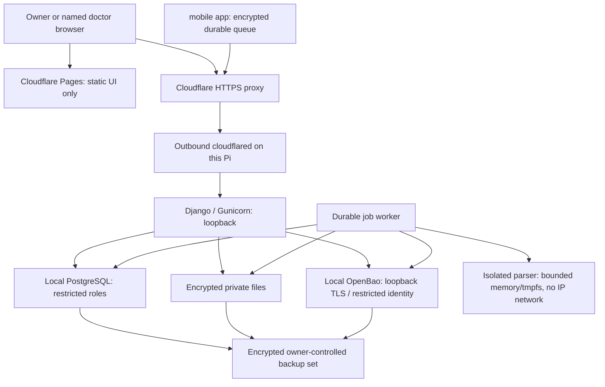

# S00 threat model

The following controls require verification for each deployment. All development uses fictional records.

## System and trust boundary

This Pi is the application and key-service host. Separate OS service identities are non-login process isolation, not additional desktop accounts or physical host separation. No hosted KMS, new provider account, subscription or Cloudflare health-data store is introduced. Pages holds only dashboard assets. The TLS proxy handles transit plaintext; disable sensitive capture and cache on dynamic routes. Browser memory holds authorized records while eligible; logout/expiry clears them. Phones upload independently at local midnight with retries.

## Actors and assets

The owner controls one patient record. Named doctors have individually scoped, read-only grants. Uninvited, unverified and recovery-only accounts have no health access. Each uploader is bound to one installation/namespace and can submit or reconcile its own receipts only. Operators administer services through the management boundary, not an app superuser backdoor. The parser receives one authorized job's bounded plaintext and cannot query records or unwrap keys.

See [column/blob inventory](data-inventory.md), [permission matrix](permission-matrix.md), [planned OpenAPI surface](../../contracts/openapi.yaml), and [fictional security fixture](../../tests/fixtures/synthetic/security-v1.json).

## Threats and planned controls

| Threat | Control | Evidence phase |
| --- | --- | --- |
| Password guessing/account enumeration | Maintained hashers, neutral auth errors, shared atomic rate limits, no public signup | S01/S03 |
| CSRF/login CSRF or hostile origin | CSRF on login and mutations; exact credentialed CORS; API-host secure cookies | S01/S03 |
| Stolen session/reset token | Idle/absolute expiry, fresh-password step-up, one-use reset, revoke prior sessions/families | S01 |
| Doctor ID guessing or aggregate leakage | Select before decrypt; all nested dependencies and counts authorized; generic 404 | S02/S06 |
| Private question parent or mixed PDF leakage | Independent question permission; omit private origin; explicit whole-document consent | S02/S04 |
| Uploader used as a read credential | Separate route authenticators, S256, namespace binding and revocable device families | S01/S02 |
| Replay/reordered revisions/deleted data | Stable IDs/revisions, immutable evidence, idempotency reauthorization, keyed tombstones | B02/S05 |
| Copied DB or tampered ciphertext | Authenticated envelopes bound to owner/object/revision; scoped local Transit keys | S02 |
| Compromised parser/hostile PDF | No network/DB/KMS, bounded IPC, tmpfs, quotas, trusted templates, no remote fetch | S04 |
| Scope change during report/download | Reauthorize enqueue/run/ready/ticket/stream, epochs and exact dependency manifest | S04/S06 |
| Secrets/health in logs/build/browser storage | Payload-free logging; no production fixtures; static-only Pages; no browser persistence | S03/S06 |
| Crash/power loss/key-service outage | Durable PostgreSQL queue, atomic encrypted objects, retry/fail closed, tested recovery | B01/S05 |
| Old restore resurrects data/access | Replay current deletion ledger; invalidate sessions/families/tickets; suspend grants | S05 |
| Unqualified sensor output misrepresented | Registry/adapter qualification, explicit absent reasons, no diagnostic inference | B03/B04 |

## Residual risks and release boundaries

Root or a compromised authorized backend on this Pi can reach plaintext. Local OpenBao does not defeat full-host compromise. A recipient can retain legitimately delivered bytes. No UI can recall a downloaded PDF or guarantee operating-system screenshot prevention. Password authentication does not protect a stolen active session. Routing metadata reveals timing/source/category. Source measurement accuracy is independent of encryption.

No claim of end-to-end encryption, HIPAA certification, continuous clinical monitoring or physical key separation is made. The key service starts sealed under the selected Shamir configuration; recovery custody and restart procedure require evidence before a real-data pilot. A backup on the same NVMe is not off-device disaster recovery. No paid backup service is required; owner-controlled storage is the intended boundary.

Production domains, verified email delivery, Android package/signing identity, off-device backup media and final offline recovery custody remain deployment inputs. They are not blockers to synthetic local implementation. Optional native capabilities stay unavailable until actual adapter evidence exists. The metrics audit's real reference sample must never become executable test or demo data.

## S00 acceptance

- Every planned entity/blob has an access owner and classification; unknown columns are prohibited.
- Every backend endpoint in the supplied matrix has a role/policy entry and OpenAPI security annotation. Unknown operations deny by default.
- Local key-service, session, native OAuth, parser, chronology and sharing decisions are explicit ADRs.
- Fixture covers two differently scoped doctors, uninvited actor, two devices, private parent/shared question, mixed document, excluded baseline contributor and a second patient.
- S00 validates design coverage only. No authentication/encryption/deployment control is marked implemented by these files.
